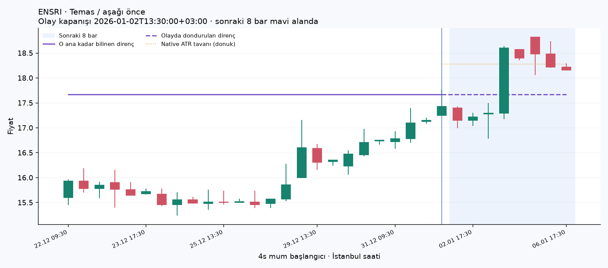
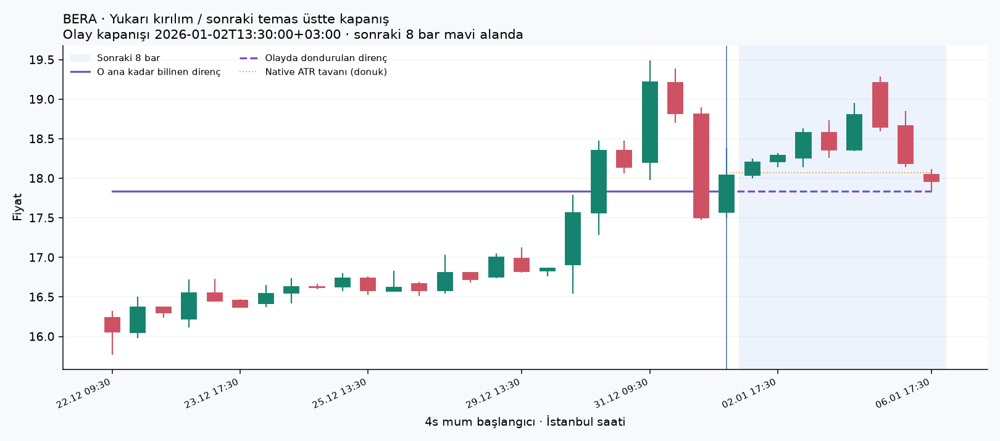
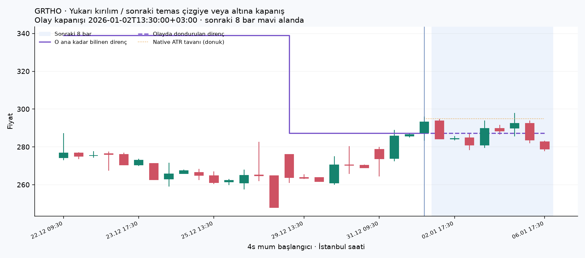

# Stabil direnç replay — somut örnekler

Bu üç örnek farklı sonuç sınıflarının **ilk kronolojik örnekleridir**, rastgele veya temsili seçim değil. Analiz çizgisi olay anında bilinen seviyedir; mavi bölgede 8 sonraki 4s mum vardır ve çizgi/tavan dondurulmuştur. Olay mumunun kapanışından önce işlem yapıldığı varsayılmaz. Aynı mum içindeki eşik sırası bilinmez.

## ENSRI — Temas / aşağı önce

Kapanış: 2026-01-02T13:30:00+03:00; seviye 17.6700, tavan 18.2807, olay kapanışı 17.4300, olay ATR 0.4596. Sonraki 8-bar kapanış +1.59 ATR; ilk ±1 ATR: DOWN_FIRST; ilk retest: uygulanmaz.

## BERA — Yukarı kırılım / sonraki temas üstte kapanış

Kapanış: 2026-01-02T13:30:00+03:00; seviye 17.8400, tavan 18.0713, olay kapanışı 18.0400, olay ATR 0.5916. Sonraki 8-bar kapanış -0.14 ATR; ilk ±1 ATR: UP_FIRST; ilk retest: TOUCH_CLOSE_ABOVE.

## GRTHO — Yukarı kırılım / sonraki temas çizgiye veya altına kapanış

Kapanış: 2026-01-02T13:30:00+03:00; seviye 287.2500, tavan 294.9021, olay kapanışı 293.2500, olay ATR 10.1262. Sonraki 8-bar kapanış -1.41 ATR; ilk ±1 ATR: DOWN_FIRST; ilk retest: TOUCH_CLOSE_AT_OR_BELOW.

