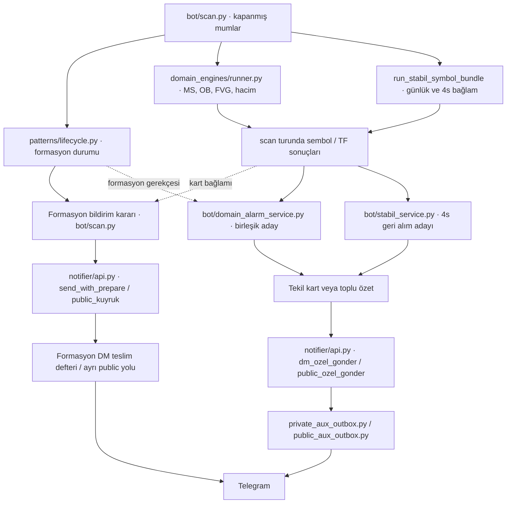

# Formation-Bot mimari merkezi

**Ana adres: `docs/mimari/README.md`** · Durum: Yürürlükte · Kaynak incelemesi: 20 Kasım 2026. Bu sayfa **kodun nasıl bağlandığını** anlatır. Belge yerleşimi için [depo düzenine](../YAPI.md), hangi kuralın yürürlükte olduğu için [belge dizinine](../README.md) bakın.

## İhtiyaca göre giriş

| Sorunuz | Başlangıç noktası | Nasıl okuyacaksınız? |
|---|---|---|
| Bu dosyayı kim kullanıyor? | [Dosya gezgini](DOSYA_HARITASI.html) | HTML’yi indirip tarayıcıda açın; internet gerekmez. Sol sütun seçilen dosyanın kendi importları, sağ sütun onu import edenlerdir. Bir komşuya tıklayıp ilerleyin. |
| Alarm fonksiyonunu kim çağırıyor? | [Çağrı listesi](ALARM_CAGRILARI.csv) | `cagrilan_fonksiyon` ile gelenleri, `cagiran_fonksiyon` ile gidenleri süzün. Dört kaynak dosyanın statik kesitidir. |
| Bir motorun çıktısı ne zaman karta dönüşüyor? | [Akış şeması](#alarm-akışı) → [domain tablosu](#hangi-domain-kullanıcıya-nasıl-yansıyor) | Önce hangi bildirim yolunda olduğunuzu bulun; sonra tetik, ön koşul ve kart metnini ayırın. |
| Hangi dosyada değişiklik yapmalı, neyi kontrol etmeliyim? | [Değişiklik ve bakım kılavuzu](BAKIM.md) | Amaca göre üreticiyi, tüketiciyi ve regresyon testini birlikte izleyin. |

## Sistem katmanları

| Katman | Sorumlu kod | Sonraki katmana verdiği şey / sınır |
|---|---|---|
| Başlatma ve zamanlama | [`main.py`](../../main.py), [`bot/app.py::main_loop`](../../bot/app.py#L253) | Ana döngü taramayı çağırır. `_pkg` üzerinden yapılan geç çağrılar salt import listesinden görünmeyebilir. |
| Veri ve mum kapanışı | [`data/fetch.py`](../../data/fetch.py), [`bot/scan.py::_completed_domain_frames`](../../bot/scan.py#L425) | Sağlayıcıdan gelen veri ile alarm hesabına giren kapanmış mum çerçevesi aynı aşama değildir. |
| Motor ve durum | [`domain_engines/runner.py`](../../domain_engines/runner.py), [`patterns/lifecycle.py`](../../patterns/lifecycle.py) | İlki domain sonuçlarını, ikincisi formasyon durumunu üretir. İkisi de tek başına gönderim değildir. |
| Karar ve kart | [`bot/scan.py`](../../bot/scan.py), [`bot/stabil_service.py`](../../bot/stabil_service.py), [`bot/domain_alarm_service.py`](../../bot/domain_alarm_service.py), [`notification_context.py`](../../notification_context.py) | Üç ayrı aday yolu bulunur. Kartta görünen bağlamın kendi başına alarm olması gerekmez. |
| Kuyruk, teslim ve görsel | [`notifier/api.py`](../../notifier/api.py), [`notification_delivery.py`](../../notification_delivery.py), [`grafik/`](../../grafik/) | Ana formasyon teslimi ve özel alarm kuyrukları farklıdır. Metin ile görselin sonucunu ve DM ile public hedefini ayrı kontrol edin. |
| Araştırma ve doğrulama | [`research/`](../../research/), [`docs/arastirma/`](../arastirma/), [`test_domain_alarm_service.py`](../../test_domain_alarm_service.py) | Replay bir davranışı ölçer, test bir sözleşmeyi kontrol eder; ikisi de dağıtımdaki botun mesaj gönderdiğini kanıtlamaz. |

## Alarm akışı

Okları soldaki bileşenin sağdakine veri vermesi veya onu çağırması olarak okuyun; bunlar teslim kaydı değildir. Taramanın giriş fonksiyonu: [`scan_all_stocks`](../../bot/scan.py#L634).

## Hangi domain kullanıcıya nasıl yansıyor?

Burada **tetik**, birleşik domain kartına gerekçe olan koşul; **bağlam**, başkasının tetiklediği kartın içeriği demek. “Tek başına tetik değil” → “projede hiç kullanılmıyor” anlamına gelmez.

| Üreten | Tetikleyen / kararı etkileyen | Üretilen ama aynı şey olmayan bilgi |
|---|---|---|
| **Market Structure** → [`runner._run_market_structure`](../../domain_engines/runner.py#L163) | [Son iki mumdaki aktif, teyitli BOS/CHoCH](../../bot/domain_alarm_service.py#L316) yönüyle gerekçe olabilir. | `external_swings`, `internal_candidates` ve yapı geçmişi var; **her swing yeni kart değildir**. Aynı bilgi Stabil tarafında karşı yapı kontrolüne de girebilir. |
| **Order Block** → [`_run_order_block`](../../domain_engines/runner.py#L292) | [Export’taki boğa/ayı bandı kapanışı içeriyorsa](../../bot/domain_alarm_service.py#L346) OB gerekçesi var. | Motor `records` ve `active_records` da üretir. Bu kapı tüm kayıtları taramaz; **ilk ziyaretle devam eden ziyaret arasında ayrım yapmaz**. |
| **FVG** → [`_run_fvg`](../../domain_engines/runner.py#L232) | Aynı bölge okuyucusu: kapanış bandın içinde **veya** FVG reaksiyon durumunda (`abs(state)==8`). | **Yeni bir gap oluşması tek başına bu kontrol değildir.** Canlı runner varsayılanıyla 1s FVG yok, 2s açıkça etkinleştirilmedikçe atlanır. Araştırma replay’inin kapsadığı TF’leri otomatik olarak canlıya yazmayın. |
| **Hacim** → [`_run_volume`](../../domain_engines/runner.py#L193) | [Motor RVOL, yoksa yerel hacim/SMA20](../../bot/domain_alarm_service.py#L378). Varsayılan 5×/10× dilimi başlı başına gerekçe. | `metrics_history` ve `lifecycle_export` da dönüyor. **Aynı seans saatine göre araştırma RVOL’ü bu canlı eşik değil.** Veri şüphesi ayrıca işaretlenir. |
| **Stabil** → [`run_stabil_symbol_bundle`](../../domain_engines/runner.py#L533) | [Birleşik kartta ön koşul](../../bot/domain_alarm_service.py#L205): geçerli `dist_atr`, varsayılan alt sınır −3 ATR. [Ayrı 4s yolu](../../bot/stabil_service.py#L240): `multi_bar_recovery` veya `intrabar_sweep_reclaim` ve diğer kontroller. | Birleşik kartta destek ilişkisi ve gösterim metni de üretir. **Her destek/direnç değişimi bağımsız bir bildirim değil.** |
| **Formasyon** → [`PatternLifecycleManager`](../../patterns/lifecycle.py#L1224) | [Ana taramada durum politikası](../../bot/scan.py#L1187); ayrıca [yeni domain kartında kaliteyi geçen formasyon kaydı](../../bot/domain_alarm_service.py#L426) gerekçe olabilir. | Aynı kayıt izleme/panel, ana formasyon bildirimi veya yeni kartın gerekçesi olabilir. `YENI_DOMAIN_ALARM_IMMEDIATE_TEKRAR` bu örtüşmenin bir kısmını yönetir; gerçekleşmiş çift teslim kanıtı değildir. |

## Kodda elle izlenen üç kritik bağlantı

1. **Motor → aday:** [`_load_domain_runner`](../../bot/scan.py#L407) `run_domain_engines` fonksiyonunu `_pkg` üzerinde saklar. [`_domain_results_for_notification`](../../bot/scan.py#L530) bunu `runner(...)` olarak çağırır, günlük veri varsa Stabil'i TF sonuçlarına ekler ve sonuçları tarama turunda önbelleğe alır. [Tarama](../../bot/scan.py#L1634) izin varsa `evaluate_stabil_4h_candidate` ve `evaluate_domain_alarm_candidates` çağrılarını ayrı yapar. Yani `_pkg` adı grafikte görünmüyor diye motor kopuk değil.
2. **Aday → kart:** [`evaluate_domain_alarm_candidates`](../../bot/domain_alarm_service.py#L458) TF/tazelik ve Stabil ön koşullarından sonra BOS, bölge, formasyon, hacim gerekçelerini **VEYA** ile birleştirir. [`dispatch_domain_alarm_candidates`](../../bot/domain_alarm_service.py#L850) tekilleştirip puanla sıralar. Varsayılan tekil sınırı 3; aşılırsa ilk iki tekil, kalanlar sayfalı özet. [Tekil kart](../../bot/domain_alarm_service.py#L669) ilk iki gerekçeyi yazıp gerisini sayıyla özetler. **Bir bilgi hesaplanmış ama tam adı mesajda görünmemiş olabilir.** Başlıca ayarlar [`config.py`](../../config.py#L914) içinde; ortam değerleri dağıtımda farklı olabilir.
3. **Kart → teslim:** [`_deliver_message`](../../bot/domain_alarm_service.py#L766) notifier yeteneğine göre yönetilen DM/public kuyruğunu veya doğrudan gönderimi seçer. [`notifier/api.py`](../../notifier/api.py#L781) yönetilen çağrıları iki ayrı `submit` yoluna bağlar. [`PublicAuxOutbox`](../../public_aux_outbox.py#L210) metin, bekleme, belirsiz sonuç ve görsel durumlarını ayırır; [`PrivateAuxOutbox`](../../private_aux_outbox.py#L19) aynı mantığı DM adaptörüyle kullanır. Ana formasyon DM’inin [`DeliveryOutbox`](../../notification_delivery.py#L190) yolu ayrıdır. **Kuyruk kabulü, DM teslimi, public teslimi ve grafik teslimi dört ayrı iddia.**

## Nereden başlamalı?

- **“Bu neden tekrar aday?”** İlk bakılacak yer [`DomainAlarmCandidate.dedup_key`](../../bot/domain_alarm_service.py#L77), [`_zaten_gonderildi` ve `_isaretle`](../../bot/domain_alarm_service.py#L619). Anahtar sembol + TF + **bar açılışı** içeriyor; okuyucu da yazıcı da bu anahtarı kullanıyor. Sonraki mumun anahtarı değiştiği için burada yazılı 6 bar ayarını tek başına *mumlar arası* bastırma garantisi saymayın. Bu bir **kod inceleme bulgusu**; kullanıcıya iki kez gittiğine dair teslim kaydı değil. Önce ardışık iki farklı bar için regresyon testi gerekir.
- **“Araştırmadaki davranış neden canlı alarm değil?”** `research/` içindeki sonucu değil, yukarıdaki tablodaki okuyucuyu izleyin. Örneğin OB’nin kaçıncı ziyareti olduğunu ölçmek ile `_bolge_sebepleri` içinde şu an bandın içinde olmak farklıdır.
- **“Kart değişsin ama tetik değişmesin.”** Birleşik kanal için `format_domain_alarm_card`; formasyon bağlamı için [`notification_context.py`](../../notification_context.py); 4s geri alım için [`format_stabil_reclaim_alert_card`](../../bot/stabil_service.py#L416). Tek bir kart şablonu yok. Başlangıç testleri: [`test_domain_alarm_service.py`](../../test_domain_alarm_service.py), [`test_stabil_scan_context_order.py`](../../test_stabil_scan_context_order.py), [`test_notification_delivery.py`](../../test_notification_delivery.py).

## Nasıl üretildi, sınırı ne?

- **GitNexus 1.6.12:** Çalışma ağacının `.git` ve ignore edilen izlenmeyen dosyalar hariç, izlenen + ignore edilmeyen dosya kopyası üzerinde `npx --yes gitnexus@1.6.12 analyze --index-only` çalıştırıldı. **16.763 düğüm, 37.791 bağ, 688 küme, 673 akış.** İndeks geçici alanda; repo’ya büyük veritabanı veya ajan entegrasyonu eklenmedi. Üç büyük araştırma JSON’u atlandı; tam metin arama eklentisi indirilemedi, **graf sorgusu çalıştı**. Akış bütçesi 1.530 olası girişin 1.330’unu sıralamaya almadı. “Grafikte yok” ≠ “çalışmıyor”.
- **Fonksiyon CSV’si:** GitNexus üzerinde `MATCH (a:Function)-[r:CodeRelation]->(b:Function) WHERE r.type="CALLS" AND a.filePath IN ["bot/scan.py","bot/stabil_service.py","bot/domain_alarm_service.py","domain_engines/runner.py"] RETURN DISTINCT a.filePath,a.name,b.filePath,b.name ORDER BY a.filePath,a.name,b.filePath,b.name` sorgusunun 182 ayrı sonucu. Kapsamı bu dört **çağıran** dosya ve `Function` tipidir; metodları, dinamik dispatch’i veya tüm repo çağrılarını listeleme iddiası yoktur.
- **HTML dosya gezgini:** Python standart kütüphanesinin AST çözümlemesi; iki dosya arasında birden çok import tek yönlü bağ, satır numaraları korunur. Çalışma ağacında 475 Python dosyası / 1.744 yönlü yerel import çifti (452 dosya Git’te zaten izleniyordu). Yenilemek için repo kökünde `python scripts/dosya_haritasi.py`. Test, araştırma ve koşullu importlar dahil; dış kütüphane, dinamik import, string konfigürasyon, HTTP çağrısı ve veri dosyası bağı bu sayıya dahil değil. Bu yüzden HTML import bağları ile GitNexus düğüm/bağ sayıları aynı evren değil.
