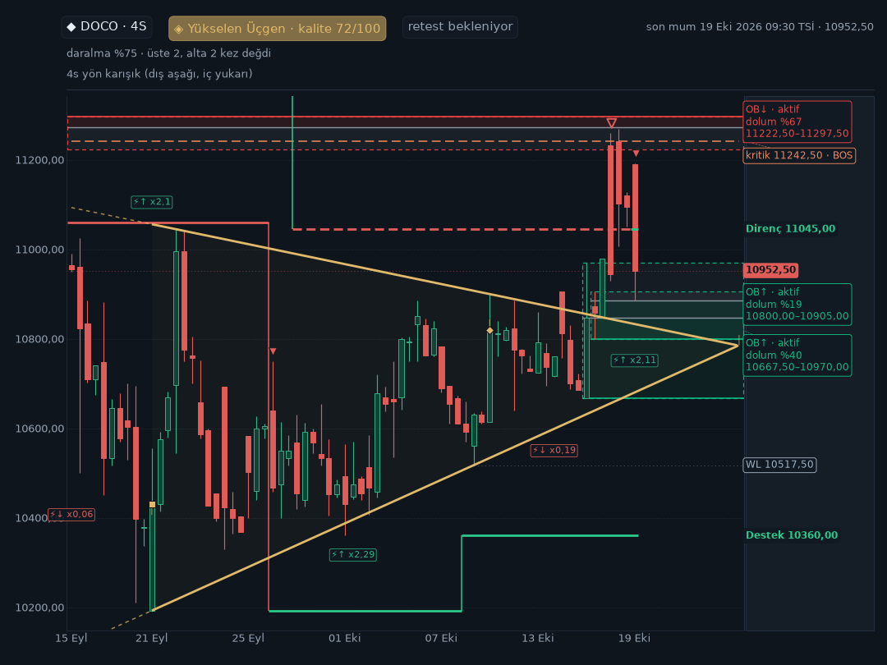
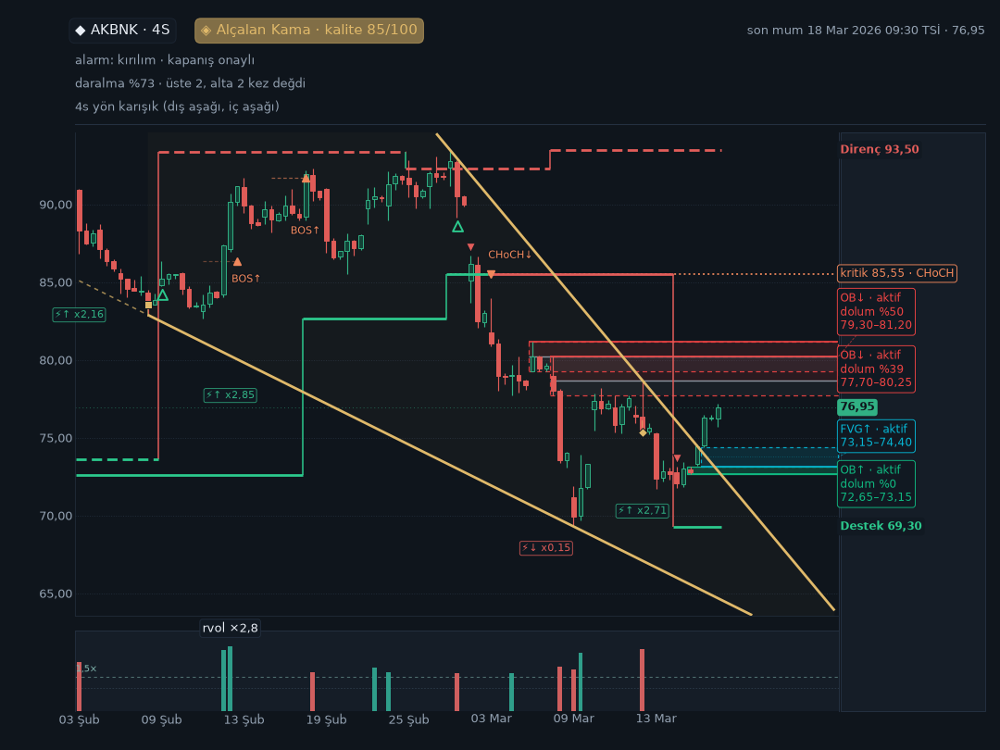
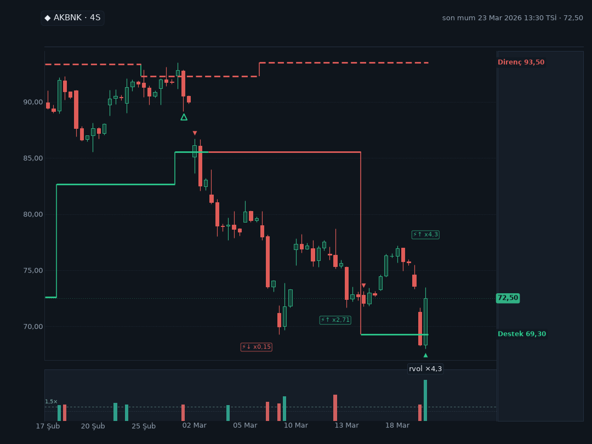
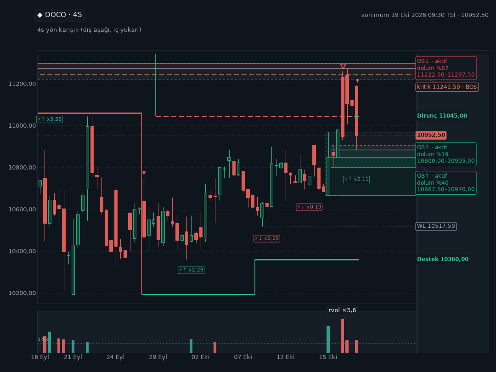

# Stabil direnç — gerçek arşivle görsel ve bildirim denetimi

**Tarih:** 7 Kasım 2026 · **Durum:** Yerel denetim; canlıya dağıtılmadı.

## Kısa sonuç

Bağımsız Stabil direnç katmanı mevcut grafiklerin içine ekleniyor; **dirence özel yeni bir alarm, otomatik mesaj veya tetikleyici yok**. Bir grafik gönderilirse çizgi ve uygun oklar, o karenin verileri güvenliyse ve çizilecek alanın içindeyse görünür. Bu iki koşul sağlanmadığında alarm metni yine gelebilir ama direnç görünmeyebilir.

**En önemli pratik fark:** Mevcut 4 saatlik Stabil destek geri-alım alarmında DM'ye metin, public hedefe metin + uygun grafik çifti gider; bu alarmın DM yolunda grafik yoktur. Normal formasyon ve domain alarmında ise DM ve public grafik yolları ayrıdır. `/grafik` komutu otomatik grafik anahtarından bağımsızdır.

Bu rapordaki fiyat ve mumlar depo arşivinden; motor, tarama/komut işçisi, grafik üretimi ve ilgili bildirim kuyruğu gerçek koddan alındı. **Telegram hedefleri ve HTTP/medya taşıması tamamen sahtedir; gerçek kullanıcıya veya gruba mesaj gönderilmedi.** Testler geçmişte seçilen kapanış anını saat olarak kullanır, gerekli mumları o ana kadar keser ve tarihsel önbelleğin tazelik kontrolünü kontrollü olarak yamalar. Bunlar canlı veri tazeliği, gerçek ağ, Telegram yetkisi veya Render Dashboard ayarlarının kanıtı değildir.

## 1. Nerede gelir?

Aşağıdaki tablo gerekli alarm, hedef ve grafik ayarlarının açık; verinin, kuyruğun ve teslimin uygun olduğu durumu anlatır. “Public”, ayarlı grup/kanal hedefidir. Kare sayıları üst sınırdır; eksik çerçeve nedeniyle daha az olabilir.

| Yol | Özel DM | Public grup/kanal | Kanıt ve sınır |
|---|---|---|---|
| `/grafik HISSE` | Komut DM'de verilirse 1s, 2s, 4s ve 1g için dört kare **denenir**. | Komut yetkili grupta verilirse sonuç aynı gruba yönlendirilir. | Gerçek DOCO komut işçisi: dört kare; ayrıca grup `sade` isteği. Otomatik grafik anahtarı kapalı olsa da komut çalışabilir. Grup yönlendirme testi yetkilendirme kapısını taklit etmedi. |
| `/grafik HISSE 4s detay` | İstenen zaman diliminde tek kare. | Yetkili grup isteğinde aynı sohbet. | Gerçek işçi ve gerçek PNG; diğer TF'ler istenirse ayrıca denenir. |
| Normal formasyon kırılımı / başarılı retest | Alarm metni ve ana TF dahil `TELEGRAM_GRAFIK_ADET` kadar, en çok 4 kare. | Metin ve normalde ana TF + uygun üst/alt TF, en çok 2 kare. | Gerçek AKBNK 18.03.2026 4s teyit: DM 4, public 2; metinler aynı. Mevcut kalite, kapanış ve teslim kapıları geçilmelidir. |
| Formasyon geçersizleşmesi | Duyurulmuş teyide bağlı mevcut kapılar uygunsa yalnız geçersizleşen TF'nin 1 karesi. | Public teyit/iptal kapıları uygunsa yalnız o TF'nin 1 karesi. | Gerçek veri ve daha önce gerçekten oluşturulmuş teyit kullanıldı; **iptal olayı kontrollü enjekte edildi**, tarihsel iptal olduğu iddia edilmiyor. DM 1, public 1. |
| 4s Stabil destek geri alımı | **Metin var, bu yoldan grafik yok.** | Metin + 4s ve mevcutsa 1g, normalde 2 kare. | Gerçek AKBNK 23.03.2026 17:30 kapanışı: destek 69,30, kapanış 72,50; public 4s+1g. |
| Mevcut domain alarmı | Metin + ana TF dahil ayarlanan 1–4 kare. | Metin + ana TF ve uygun ek TF, normalde 2 kare. | Gerçek DOCO 19.10.2026 4s `CHoCH ↑`: DM 4, public 2. Bu, dirençten doğan yeni bir alarm değil. |
| Stabil/domain toplu özeti | Özet metni, **özetin kendisine grafik yok**. | Özet metni, **özetin kendisine grafik yok**. | Varsayılan eşik 3'ün üstünde ilk 2 aday tekil karta, kalanlar özet(ler)e gider. Dört gerçek 4s domain adayıyla sınandı. |

Formasyon ve domain public çiftinin mevcut zaman dilimi kuralı: **1s → 4s, 2s → 4s, 4s → 1g, 1g → 4s**. İkinci çerçeve yoksa tek kare kalabilir. Normal public çiftinin iki karelik seçimi DM'nin `TELEGRAM_GRAFIK_ADET` sınırından ayrıdır: testte DM sayısı 1 iken public 2 kare aldı. Formasyon bandı ve olay işareti yalnız kendi ana TF'sine aittir; diğer TF'de taşınmaz, ama o karenin kendi Stabil direnç katmanı ayrıca hesaplanabilir.

### Otomatik grafik anahtarı ve yetki

- `TELEGRAM_GRAFIK=yok` veya boşsa **otomatik alarm grafikleri kapalıdır**. Alarm metni politikası ayrı çalışır; `/grafik` bu anahtara bağlı değildir. Grafik denemek için amaçlanan değer `TELEGRAM_GRAFIK=alarm`dır.
- Depodaki `render.yaml` ve `.env.example` örneği `TELEGRAM_GRAFIK=yok` der. **Gerçek Render Dashboard değeri burada görülmedi**, dolayısıyla canlıda açık veya kapalı olduğu söylenemez.
- `TELEGRAM_GRAFIK_ADET` DM alarmında 1–4 arasında, varsayılan 4'tür. Public çift ve geçersizleşmenin tek-kare istisnası yukarıdaki gibidir.
- Grup tarafında `/grafik` varsayılan olarak kapalıdır; yetkili yönetici ve uygun `PUBLIC_COMMAND_EXTRA` yapılandırması gerekir. Grafik gönderim izni de ayrıca gerekir. Bu denetimde yalnız komut işçisinin **izin verilmiş bir grup isteğini nereye yönlendirdiği** simüle edildi; Telegram üyeliği, yönetici yetkisi veya izinler doğrulanmadı.

## 2. Gerçek verili görseller

Tüm görseller gerçek renderer çıktısıdır. Üst sağdaki `son mum ...` etiketi çoğu intraday karede **mumun açılış zamanıdır**; olayın kapanışı ayrı hesaplanır. Örneğin DOCO 19 Ekim 09:30 mumunun 4s kapanışı 13:30'dur. Fiyatlar tarihsel arşive aittir, bugünün fiyatı değildir.

### `/grafik`: DOCO 4s, 19.10.2026 13:30 kapanışı

[PNG'yi aç](../gorseller/stabil_direnc_teslim_denetimi_2026_11_07/01_doco_grafik_4s.png) · [Aynı isteğin günlük karesi](../gorseller/stabil_direnc_teslim_denetimi_2026_11_07/02_doco_grafik_1g.png)

Direnç **11.045**, 4s son kapanış **10.952,50**, destek **10.360**. Kesikli direnç, düz destek ve mevcut üçgen/domain katmanları birlikte çizilmiş. 16 Ekim 13:30 kapanışındaki aşağı momentum için boş kırmızı `▽`, 19 Ekim 13:30 kapanışındaki direnç altına güçlü dönüş için dolu kırmızı `▼` var. Bunlar grafik işaretidir; kendi başına Telegram alarmı değildir.

Dikkat: Son direnç çipi bu karede yeşilken 4s son kapanış direncin altında. Çelişki gibi görünen durumun nedeni, çizginin renk rolünün her 4s kesişimde değil **son kullanılabilir native günlük snapshot'a göre** taşınmasıdır: 16 Ekim günlük kapanışı 11.100 > 11.045. Geçmiş parçalar önceki günlük snapshot nedeniyle kırmızı kalabilir. 19 Ekim'in tamamlanmamış günlük mumu 13:30 kesimine sokulmadı.

### Normal formasyon: AKBNK 4s, 18.03.2026 13:30 kapanışı

[PNG'yi aç](../gorseller/stabil_direnc_teslim_denetimi_2026_11_07/05_akbnk_formasyon_4s.png) · [Aynı alarmın 1s karesi: direnç kadraj dışında](../gorseller/stabil_direnc_teslim_denetimi_2026_11_07/06_akbnk_formasyon_1s_kadraj_disi.png)

Gerçek `PatternLifecycleManager` ve gerçek tarama, **Alçalan Kama / KIRILIM_TEYITLI**, kalite yaklaşık 85,49, kapanış **76,95** ve kırılan sınır yaklaşık **73,94** buldu. DM/public'e aynı kart üretildi. 4s karede kesikli kırmızı direnç **93,50**; 1s karede aynı direnç motoru `READY` olmasına rağmen fiyat kadrajının dışında olduğundan çizgi ve çip görünmedi. Bu somut örnekte otomatik 1s altyazısı özellikle “direnç kadraj dışında” demiyor; `hazir=true` **görünürlük garantisi değildir**.

### Stabil destek alarmı: AKBNK 4s, 23.03.2026 17:30 kapanışı

[Public 4s PNG](../gorseller/stabil_direnc_teslim_denetimi_2026_11_07/07_akbnk_stabil_public_4s.png) · [Public 1g PNG](../gorseller/stabil_direnc_teslim_denetimi_2026_11_07/08_akbnk_stabil_public_1g.png)

Kapanış **72,50**, güçlü geri alınan destek **69,30**, direnç **93,50**. Geri-alım oku ve destek görünür; direnç ayrı kesikli çizgidir. Bu tam taramada DM yalnız metin, public 4s+1g aldı. Aynı taramada mevcut domain kanalı ayrıca 4s `BOS ↓` ve 2s formasyon bağlamı kartları üretti; bunlar bağımsız mevcut tetikleyicilerdir.

**Mevcut destek davranışı hakkında dürüst not:** Bu taramada Stabil adayı, domain sonuçları önceden önbellekte yokken izole 4s destek hesabıyla hazırlandığı için public **günlük** karesinde destek katmanı yok; aynı karede bağımsız günlük direnç hazır ve çizili. Başka bir testte önceden doldurulmuş günlük destek sonucu varken günlük destek de çizildi. Bu, direnç ekinden önceki cache/akış tercihiyle tutarlıdır; mevcut destek algoritması veya mesajı bu çalışmada değiştirilmedi. Günlük destek her Stabil public karesinde mutlaka var denemez.

### Mevcut domain alarmı: DOCO 4s CHoCH

[DM 4s PNG](../gorseller/stabil_direnc_teslim_denetimi_2026_11_07/09_doco_domain_choch_4s.png)

DOCO'nun gerçek yapı motoru aynı 19 Ekim kapanışında `CHoCH ↑` adayı üretti. Metin DM/public'te aynı; DM sırasıyla 4s, 1s, 2s, 1g, public ise 4s+1g PNG aldı. 4s direnç ve iki tür aşağı işaret mevcut. Bu test `TELEGRAM_GRAFIK_ADET=4` ile yapıldı. Domain adayı doğrudan değerlendirilen bu senaryoda ayrıca formasyon bağlamı verilmediğinden, manuel karedeki üçgen bu karede yoktur; tam tarama varsa mevcut formasyon bağlamını ayrıca aktarır.

### Diğer incelenen kareler

| Görsel | Ne gösteriyor? |
|---|---|
| [DOCO grup, `sade`](../gorseller/stabil_direnc_teslim_denetimi_2026_11_07/03_doco_sade_grup_4s.png) | Kaynakta direnç hazır olsa da sade görünüm hem destek hem direnç katmanını **bilinçli gizliyor**; formasyon bandı kalıyor. |
| [DOCO, günlük kaynak kaldırılmış](../gorseller/stabil_direnc_teslim_denetimi_2026_11_07/04_doco_gunluk_eksik_4s.png) | Grafik gelir, direnç/destek çizilmez; manuel altyazıda gerekli kaynak yok uyarısı görünür. |
| [AKBNK kontrollü geçersizleşme](../gorseller/stabil_direnc_teslim_denetimi_2026_11_07/10_akbnk_gecersiz_kontrollu_4s.png) | Gerçek arşiv ve daha önceki gerçek teyit kullanıldı; iptal transition'ı testte enjekte edildi. Sadece 4s kare. |
| [EREGL 4s BOS](../gorseller/stabil_direnc_teslim_denetimi_2026_11_07/11_eregl_burst_domain_4s.png) · [KCHOL 4s BOS](../gorseller/stabil_direnc_teslim_denetimi_2026_11_07/12_kchol_burst_domain_4s.png) | Aynı tarihsel kapanışta gerçek adaylardan oluşturulan dört adaylı 4s-only burst testinin iki tekil kartı. |

Toplu testte **EREGL** ve **KCHOL** iki yüksek sıralı tekil kart olarak DM/public grafiği aldı; gerçek **DOCO CHoCH** ve **EFOR BOS** adayları yalnız metin özetinde yer aldı. Aynı adaylar yeniden gönderilmeye çalışıldığında dört tekrar filtrelendi. Bu, seçilmiş dört sembolün yalnız 4s adaylarıyla yapılan kontrollü bir testtir; tüm piyasa/tüm zaman dilimleriyle o tarihteki canlı taramanın kaydı değildir.

## 3. Ne zaman görünmez veya hiç gelmez?

1. **Alarm üretilmezse otomatik grafik de yoktur.** Formasyon kalite/teyit/tazelik, daha önceki teyit, cooldown/tekrar ve hedef filtreleri; Stabil destek geri-alım koşulları; domain için mevcut nedenler ve eşikler aynen uygulanır. Direnç çizgisi bu kapıları açmaz.
2. **Gerçek retest ama alarm yok:** AKBNK 23 Mart 17:30 kapanışında formasyon motoru `RETEST_BASARILI` görür; kapanış 72,50, yukarı kırılımda dondurulmuş sınır yaklaşık 73,94'tür. Mevcut kapanış-teyit kapısı geçilmediği için normal formasyon push'u gönderilmez. Aynı anda bağımsız Stabil/domain kanallarının alarm vermesi bunu değiştirmez.
3. **Grafik kapalıysa:** `TELEGRAM_GRAFIK=yok` otomatik kareleri kapatır; mevcut metin politikası ve manuel `/grafik` ayrıdır. Gerçek Stabil/domain adaylarının grafik açık/kapalı alan dışındaki verileri bu testte eşitti.
4. **`sade` görünüm:** `/grafik ... sade` veya otomatik renderer'a uygulanan `GRAFIK_SADE=1`, hem destek hem direnç katmanını gizler. Bu veri hatası değil görünüm tercihidir. Komutta `detay` açıkça seçilebilir.
5. **Kaynak veya doğrulama yetersizse:** Native günlük kaynak, intraday karenin kapanmış 1s bileşenleri, zaman sırası/kalitesi veya hedef kaynak eşleşmesi gerekli koşulları sağlamıyorsa direnç güvenli biçimde bastırılır. Örnek nedenler `missing_source`, eksik saatlik kova, `target_source_mismatch`, takvim kapanış uyuşmazlığı ve tespit edilen `daily_split_scale_unverified` durumudur. Manuel komutun test edilen detay altyazısı bunu açıkça bildirdi; otomatik public altyazıları her nedeni göstermeyebilir. Yalnız intraday `/grafik` istenirken eksik native günlük kaynak için yeni ve ayrı bir günlük ağ isteği garanti edilmez.
6. **Seviye henüz bilinmiyorsa veya kadraj dışındaysa:** Pivot native teyidinden önce gelecek bilgisi çizilmez. Hazır seviye çok uzaktaysa mumlar aşırı sıkıştırılmasın diye çizgi/çip görünmeyebilir; AKBNK 1s örneği yukarıda. Bir okun üretildiği bar, gösterilen yatay aralığın dışında da kalabilir.
7. **Burst veya tekrar:** Eşik üstü Stabil/domain adaylarında tekil kartlar dışındakiler grafik yerine özete girebilir; aynı olayın tekrar mührü/cooldown'ı yeni mesajı engelleyebilir.
8. **Teslim/izin/kapasite sorunu:** Hedef veya bot izni, bütçe, kuyruk, disk, render ve ağ başarısızlıkları DM ile public'i farklı etkileyebilir. Domain alarmında gerçek PNG hazırlayıp medya sonucunu kontrollü belirsiz yaptığımız testte iki metin başarılı sayıldı, iki hedefte grafik durumu `graphics_uncertain` oldu ve çift gönderim riskine karşı otomatik tekrar yapılmadı. Bu **teslim edildiği kanıtı değildir**; operatör incelemesi gerekir. Normal formasyonun kalıcı DM kuyruğunda hazırlık hatası metni de bekletebilir; bütün yolların hata davranışı aynı değildir.

Veri kontrolleri bilinen hatalarda kapanır, ancak sağlayıcının hiç yollamadığı veya yanlış etiketlediği tüm verileri, tespit edilemeyen kurumsal aksiyonları ve bazı tamamen eksik son seans durumlarını tek başına kanıtlayamaz. Mevcut tazelik ve kaynak denetimleri önemini korur. Önceki yerel 50 hisselik 4s arşiv örnekleminde 46 `READY`, 4 güvenli kapanma görüldü; bu tüm canlı evren için başarı oranı değildir.

## 4. Renk ve okları okuma

- Destek düz; direnç kesiklidir. Normal direnç rolü kırmızı, desteğin kırmızı karşıt rolü dirençte yeşildir. Eşitlikte günlük kapanış `<= direnç` kırmızı taraftadır. Rol günlük snapshot'tan aktarılır, intraday her kesişimde otomatik renk değiştirmez.
- Dolu kırmızı `▼`: güçlü aşağı dönüş; boş kırmızı `▽`: güçlü aşağı momentum; boş yeşil `△`: aday dikey yapı uyarısı. Üç barlık momentum-ok tekrar kısıtı yönce ters uygulanır. Native pivot teyidi üzerine keyfî ek 2/3/5 bar bekleme eklenmedi.
- Yükselen direnç basamağının bağlantısı kırmızı, düşen bağlantı yeşildir. Bir bağlantı çizgisinin dik olması, kullanıcının tarif ettiği görsel dikey rejimin doğrulandığı anlamına gelmez; aday uyarısı yön tahmini değildir.
- Grafik içi lejant varsayılan olarak kapalıdır. Diğer domain çizgileri, bölgeleri ve onların işaretleri direnç oklarından ayrılmalıdır. BOS filtresi/üç barlık kısıtın etkisi replay'i ve güçlü-zayıf destek oku araştırması **henüz yapılmadı**, ayrı bekleyen iştir.

## 5. Test kapsamı ve tekrarlama

- Yeni `test_stabil_resistance_delivery_e2e.py`: **15 başarılı**. Gerçek arşiv → üretim motoru → gerçek komut veya tarama → gerçek notifier/kuyruk → gerçek PNG → sahte taşıma. Bazı kontrol senaryoları yukarıda açıkça belirtilen şekillerde enjekte edilir.
- Önceden: grafik köprüsü/snapshot/render/entegrasyon ve native direnç testleri; normal formasyon ve yardımcı public kuyruğunun diske yazılıp yeniden yüklenmesi; dört tarihsel araştırma doğrulayıcısı. Bunlar gerçek Telegram veya deploy testleri değildir.
- Son tam regresyon: **4.057 başarılı, 43 atlandı**, Python 3.11.2; tek koşu, çıkış kodu 0. `ruff check .` ve `git diff --check` başarılı.
- Tekrar: `.venv/bin/python -m pytest -q test_stabil_resistance_delivery_e2e.py`; tam paket: `.venv/bin/python -m pytest -q`; kalite: `.venv/bin/ruff check .`.
- [Makinece okunur görsel, altyazı, simüle mesaj ve metadata kayıtları](../gorseller/stabil_direnc_teslim_denetimi_2026_11_07/KANIT_KAYITLARI.json). JSON içindeki albüm adları testin geçici dosya adlarıdır; yalnız yukarıda listelenen seçilmiş PNG'ler kalıcı olarak kopyalandı. Kimlikler `SAHTE_DM`/`SAHTE_PUBLIC` olarak etiketlenmiştir.

**Canlıya hazır hükmü:** Yerel akışlar ve seçilmiş gerçek geçmiş örnekleri doğrulandı. Canlı Render Dashboard değerleri, gerçek Telegram grup yetkileri, gerçek güncel veri/kaynakların tümü ve gerçek teslim doğrulanmadı. Dağıtım veya gerçek mesaj gönderimi bu çalışma kapsamında yapılmadı.
